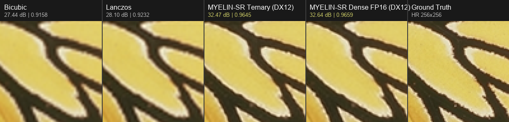

# MYELIN-SR: 1.58-Bit Ternary vs. Native FP16 Super-Resolution in DirectX 12

An empirical GPU systems study comparing **2-bit packed ternary (`{-1, 0, +1}`) compute shaders** against **native FP16 (`HFMA2`) compute shaders** for real-time 2× neural super-resolution in DirectX 12 (HLSL SM 6.0 / SM 6.2).

**Core Finding:** On a 22.9k-parameter ESPCN-style architecture (`3 → 32 → 32 → 32 → 12` + 2× PixelShuffle + global bilinear skip), 1.58-bit ternary quantization-aware training (QAT) loses only **0.03 dB** on held-out Set14 compared to continuous FP16 (`32.29 dB` vs. `32.32 dB`, both beating Bicubic by `+2.0 dB`). However, on an NVIDIA RTX 5050 Laptop GPU, **native Dense FP16 is 2.65× faster (`8.60 ms / 116.3 FPS` vs. `22.75 ms / 44.0 FPS` at 540p → 1080p)** because both weight sets fit entirely in L1/L2 cache, turning bit-unpacking into pure ALU overhead.



---

## 1. Speed × Quality × Size Summary

All models are trained from scratch on 50 disjoint natural images from BSD100 (Charbonnier L1 loss, 150 epochs, Cosine Annealing) and evaluated dynamically on held-out **Set5** and **Set14** (BT.601 Y-channel, 2 px border shave). GPU latency is measured with `ID3D12QueryHeap` (`D3D12_QUERY_TYPE_TIMESTAMP`) over 50 iterations after 15 warmups on an **NVIDIA GeForce RTX 5050 Laptop GPU** (Release `/O2`).

| Method | Backbone Precision | Backbone / Total Weights | Set5 Y-PSNR / SSIM | Set14 Y-PSNR / SSIM | 540p → 1080p (DX12) | 720p → 1440p (DX12) |
| :--- | :---: | :---: | :---: | :---: | :---: | :---: |
| **Bicubic (PIL)** | Analytical | 0 KB | 33.67 dB / 0.9303 | 30.32 dB / 0.8698 | — *(CPU ref)* | — *(CPU ref)* |
| **Lanczos (PIL)** | Analytical | 0 KB | 34.31 dB / 0.9364 | 30.78 dB / 0.8800 | — *(CPU ref)* | — *(CPU ref)* |
| **MYELIN-SR Ternary (QAT)** | 1.58-bit (`{-1,0,+1}`) | **4.8 KB** / **11.5 KB**\* | 36.37 dB / 0.9533 | 32.29 dB / 0.9056 | 22.75 ms (44.0 FPS) | 40.75 ms (24.5 FPS) |
| **MYELIN-SR Dense (FP16)** | 16-bit Float | 37.7 KB / 44.4 KB | **36.42 dB / 0.9539** | **32.32 dB / 0.9062** | **8.60 ms (116.3 FPS)** | **16.00 ms (62.5 FPS)** |

*\*Hybrid precision: 3-layer 2-bit packed ternary backbone (`4.8 KB`, `7.93×` smaller than FP16) + shared 12-channel FP16 reconstruction head (`6.8 KB`), excluding `0.8 KB` of FP32 scales/biases.*

On high-frequency edges (`Set5/butterfly.png`, shown above), MYELIN-SR reaches **32.64 dB / 0.9659 SSIM** (Dense FP16) and **32.47 dB / 0.9645 SSIM** (Ternary QAT), versus **27.44 dB** (Bicubic) and **28.10 dB** (Lanczos).

---

## 2. DX12 Kernel Progression & Roofline Analysis

Every shader variant executes the identical 5-pass graph (`3→32`, `32→32`, `32→32`, `32→12`, `PixelShuffle 2× + Bilinear Skip`) from `D3D12_HEAP_TYPE_DEFAULT` VRAM buffers with tracked `UAV ↔ NON_PIXEL_SHADER_RESOURCE` state transitions and is validated against PyTorch golden outputs before timing is accepted.

### 960×540 → 1920×1080 & 1280×720 → 2560×1440 (RTX 5050 Laptop GPU)

| Variant | Parity vs. PyTorch | 540p Median | 540p FPS | 720p Median | 720p FPS | Scaling (1.78× px) |
| :--- | :---: | :---: | :---: | :---: | :---: | :---: |
| **1. Ternary Naive (FP32)** | PASS (`1.19e-07`, 1 ULP) | 75.96 ms | 13.2 | 129.41 ms | 7.7 | 1.70× |
| **2. Ternary LDS 16×16 (FP32)** | PASS (`1.19e-07`, 1 ULP) | 71.14 ms | 14.1 | 126.06 ms | 7.9 | 1.77× |
| **3. Dense LDS 16×16 (FP32)** | PASS (`1.19e-07`, 1 ULP) | 47.45 ms | 21.1 | 83.86 ms | 11.9 | 1.77× |
| **4. Ternary LDS 16×16 (FP16)** | PASS (`4.71e-04`) | 61.97 ms | 16.1 | 119.63 ms | 8.4 | 1.93× |
| **5. Dense LDS 16×16 (FP16)** | PASS (`4.71e-04`) | 37.61 ms | 26.6 | 74.99 ms | 13.3 | 1.99× |
| **6. Ternary OC8-Vec2 (FP16)** | PASS (`4.71e-04`) | 22.75 ms | 44.0 | 40.75 ms | 24.5 | 1.79× |
| **7. Dense OC8-Vec2 (FP16)** | PASS (`4.71e-04`) | **8.60 ms** | **116.3** | **16.00 ms** | **62.5** | **1.86×** |

### Per-Layer Breakdown (Variant 7: Dense OC8-Vec2 FP16)
* **540p → 1080p:** `L0=0.367 ms` | `L1=3.349 ms` | `L2=3.347 ms` | `L3=1.397 ms` | `L4 (PixelShuffle+Skip)=0.167 ms`
* **720p → 1440p:** `L0=0.678 ms` | `L1=6.268 ms` | `L2=6.264 ms` | `L3=2.591 ms` | `L4 (PixelShuffle+Skip)=0.311 ms`

### Why 2-Bit Ternary Loses to Native FP16 Here

1. **Eliminating the 40× activation reload tax (`37.61 ms → 8.60 ms`):** Variants 2–5 mapped 1 output channel per threadgroup (`dispatch.z = 32`), forcing every `16×16` spatial tile to be reloaded into LDS 32 separate times. `myelin_v3_ocblock.hlsl` maps `32×16` pixels × `8` output channels per threadgroup (`float16_t2` vectorization, bank-conflict-padded `18×36` `groupshared` tile), reusing each loaded neighborhood across 8 output channels in registers (`4.37×` speedup over Variant 5, `8.83×` over Naive).
2. **Weights are cache-resident, not DRAM-bound:** At `4.8 KB` (ternary) and `44.4 KB` (dense FP16), 100% of weights stay resident in L1/L2 cache across the entire frame. Weight compression saves zero off-chip memory traffic.
3. **Bit-unpacking ALU tax vs. `HFMA2`:** Once activation reloads were removed, the bottleneck shifted to SM ALU throughput. Unpacking 2-bit codes (`shift`, `mask`, `code == 1/2` branching) consumes ~3× more ALU instructions per weight than issuing packed `HFMA2` (`float16_t2` fused multiply-add) on the SM's FP16 vector ALU pipelines, widening the Dense-vs-Ternary gap from `1.65×` to `2.65×`. Sub-byte ternary weights only win when models are **DRAM weight-bandwidth bound** (e.g., multi-billion-parameter LLMs).

---

## 3. Repository Layout

* `src/myelin_v3.hlsl` — Reference FP32 compute shader (1-ULP PyTorch parity oracle)
* `src/myelin_v3_bench.hlsl` — Parameterized Naive & cooperative LDS (`18×18`) FP32/FP16 shader
* `src/myelin_v3_ocblock.hlsl` — SM 6.2 `OC_TILE=8` register-blocked + `float16_t2` vectorized shader
* `src/dx12_parity_test.cpp` — Debug-layer-verified DX12 parity harness (`outputs/parity_v3/gpu_output.png`)
* `src/dx12_bench_v3.cpp` — 7-variant DX12 roofline harness with GPU timestamp queries and `--save-gpu-png` readback
* `tools/export_parity_v3.py` & `tools/export_bench_v3.py` — Deterministic PyTorch-to-`MBN3` binary exporters (per-OC 16-weight word alignment)
* `train/train_v3.py` — Clean Dense & 1.58-bit Ternary QAT trainer + dynamic Set5/Set14 evaluator

---

## 4. Build & Reproduce

Requires **Windows 10/11**, **MSVC (x64 Native Tools Command Prompt)**, **DXC** (`dxc.exe` + `dxil.dll`), and **Python 3 + PyTorch + Pillow**.

```cmd
:: 1. Export 540p -> 1080p benchmark workload + PyTorch golden reference
python tools\export_bench_v3.py --width 960 --height 540 --channels 32 --layers 3 --out outputs\bench_540p

:: 2. Compile all 7 shader variants
dxc -T cs_6_0 -E CSMain -O3 -DUSE_LDS=0 -DFORCE_DENSE=0 -DUSE_FP16=0 -Fo outputs\bench_540p\v3_ternary_naive_fp32.cso src\myelin_v3_bench.hlsl
dxc -T cs_6_0 -E CSMain -O3 -DUSE_LDS=1 -DFORCE_DENSE=0 -DUSE_FP16=0 -Fo outputs\bench_540p\v3_ternary_lds_fp32.cso   src\myelin_v3_bench.hlsl
dxc -T cs_6_0 -E CSMain -O3 -DUSE_LDS=1 -DFORCE_DENSE=1 -DUSE_FP16=0 -Fo outputs\bench_540p\v3_dense_lds_fp32.cso     src\myelin_v3_bench.hlsl
dxc -T cs_6_2 -E CSMain -O3 -enable-16bit-types -DUSE_LDS=1 -DFORCE_DENSE=0 -DUSE_FP16=1 -Fo outputs\bench_540p\v3_ternary_lds_fp16.cso src\myelin_v3_bench.hlsl
dxc -T cs_6_2 -E CSMain -O3 -enable-16bit-types -DUSE_LDS=1 -DFORCE_DENSE=1 -DUSE_FP16=1 -Fo outputs\bench_540p\v3_dense_lds_fp16.cso   src\myelin_v3_bench.hlsl
dxc -T cs_6_2 -E CSMain -O3 -enable-16bit-types -DFORCE_DENSE=0 -Fo outputs\bench_540p\v3_ternary_oc8_fp16.cso src\myelin_v3_ocblock.hlsl
dxc -T cs_6_2 -E CSMain -O3 -enable-16bit-types -DFORCE_DENSE=1 -Fo outputs\bench_540p\v3_dense_oc8_fp16.cso   src\myelin_v3_ocblock.hlsl

:: 3. Build & run Release benchmark + parity verification
cl /EHsc /MD /O2 /std:c++17 src\dx12_bench_v3.cpp /Fe:dx12_bench_v3.exe
dx12_bench_v3.exe outputs\bench_540p

:: 4. Train Dense & Ternary checkpoints and export real GPU upscaled photos
python train\train_v3.py --mode dense   --train-dir data\train_hr --val-dir data\Set5 --out-dir outputs\trained_dense   --epochs 150
python train\train_v3.py --mode ternary --train-dir data\train_hr --val-dir data\Set5 --out-dir outputs\trained_ternary --epochs 150
dx12_bench_v3.exe outputs\trained_dense\dx12_bundle --save-gpu-png
```

---

## 5. Known Limitations & Planned Work

1. **Spatial-only pass:** No motion vectors or temporal accumulation; moving camera feeds will exhibit sub-pixel shimmer compared to TAAU/DLSS/FSR 2+.
2. **Further FP16 kernel headroom:** Current CHW layout caps L1/L2 at ~2.85 TFLOPs on RTX 5050. Switching activations/weights to NHWC with `float16_t4` loads (or DX12 Cooperative Vectors for Tensor Core MMA) should push 540p → 1080p well below 4 ms.
3. **Cross-architecture profiling:** Turing (GTX 1650, TU117) numbers from the exact same binary will be added alongside Blackwell (RTX 5050) to compare ALU vs. bandwidth ratios across generations.

---

## License

GNU General Public License v3.0 (GPLv3). See [LICENSE](LICENSE).
